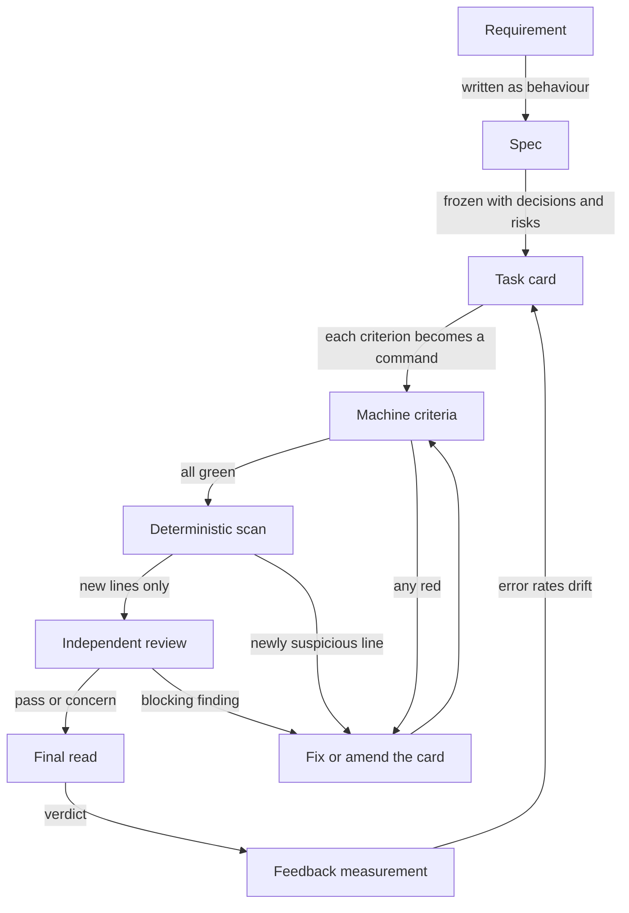

# The acceptance pipeline

Turning "the agent says it is done" into "a machine agreed, and here is the output". Six layers,
cheapest first; each answers what it guarantees, what it cannot catch, and where a failure goes back
to.

## Data flow

The back-arrow from measurement to the card is the point: a loop expected to be retuned, not a one-
way gate.

## Layer 1 — Spec

**Guarantees:** the requirement exists as behaviour someone could disagree with —
"list only items carrying the tag", not "support tags".
**Cannot catch:** a spec that is precise about the wrong thing.
**Goes back to:** the requester. Do not start on a spec you cannot test.

## Layer 2 — Task card

**Guarantees:** the spec frozen with the decisions that would otherwise be
re-litigated mid-flight, the risks plus the criterion catching each, and the boundary of what may be
touched.
**Cannot catch:** risks nobody imagined; the section is a floor, not a ceiling.
**Goes back to:** the card. A decision that is not written down amends the card
first — the most useful rule here, because it stops scope from being invented.

## Layer 3 — Machine criteria

**Guarantees:** every criterion is a command with an expected result, run for real,
output quoted. A return code cannot be talked out of.
**Cannot catch:** a criterion passing for the wrong reason — a test asserting on
nothing is green too, which is why the layers continue past this one.
**Goes back to:** the implementation, or the card if the criterion was wrong.
Telling those apart is most of the skill.

Three rules keep this layer honest:

- one criterion, one deciding command — an `&&`-chain hides which link failed;
- compare numbers numerically; whitespace from `wc -l` has caused more false reds
  than any real defect;
- separate "violation found" from "could not check", or the pipeline cannot stay
  trustworthy when the environment breaks.

## Layer 4 — Deterministic scan

**Guarantees:** the cheap-to-see failure shapes are seen, new lines only, by rules
that do not get tired.
**Cannot catch:** anything needing to know what the code is for — a swallowed
exception is visible, a wrong algorithm is not.
**Goes back to:** the implementation. A scan that shouts about old debt gets muted.

## Layer 5 — Independent review

**Guarantees:** a second reading by something that did not write the code and has no
stake in the claim.
**Cannot catch:** a defect both share a blind spot for — independence lowers
correlation, it does not remove it.
**Goes back to:** the implementation, finding quoted verbatim. See
[judge-independence.md](judge-independence.md).

## Layer 6 — Feedback measurement

**Guarantees:** the pipeline's own errors are counted, in both directions.
**Cannot catch:** a metric that quietly stopped measuring what it names.
**Goes back to:** earlier layers, usually the card schema. Defects escaping one
layer mean that layer's criteria are too weak. See [misjudgment-monitoring.md](misjudgment-
monitoring.md).

## The whole thing as an eval harness

The six layers are a small eval harness for the work itself: a fixed input (the card), a fixed
judgement (the criteria), a recorded verdict, and a measured error rate feeding back into the input.
The harness is the point; any single gate inside it is replaceable.

## What it cannot buy

A green pipeline is an argument, not a proof: it says the stated criteria were met. Whether they
were the right criteria is a human judgement made at the card — the part worth spending attention
on.
